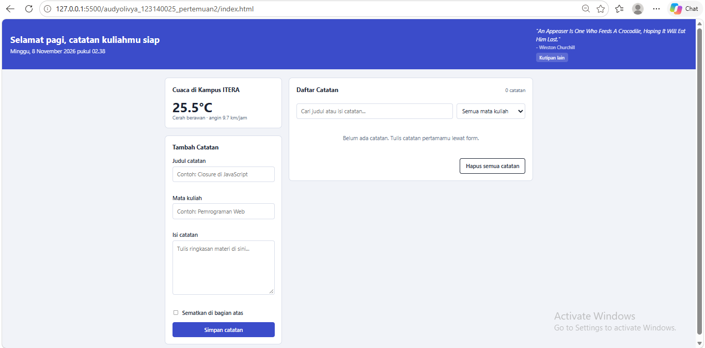
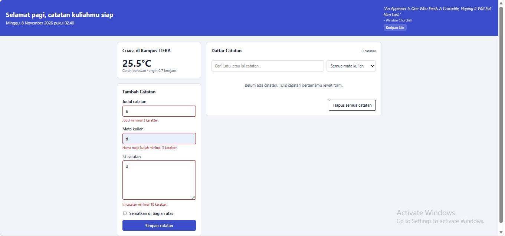
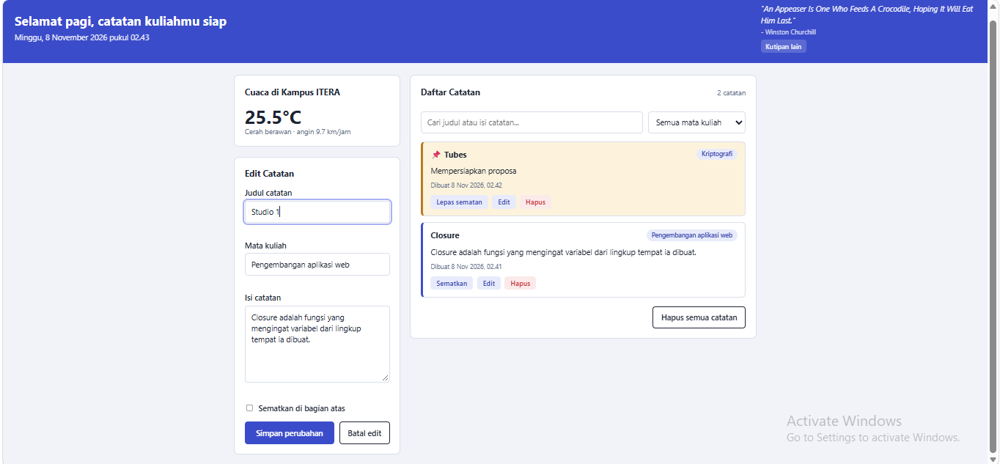

# Catatan Kuliah ITERA

## Identitas
- **Nama Lengkap:** [Audy Olivya Br Gurusinga]
- **NIM:** 123140025
- **Kelas Praktikum:** [RB]

## Deskripsi Aplikasi
Catatan Kuliah ITERA adalah dashboard pribadi untuk mahasiswa yang ingin merapikan catatan materi per mata kuliah. Pengguna dapat menulis, mengedit, mencari, mengelompokkan, dan menyematkan catatan penting. Semua catatan tersimpan di `localStorage` sehingga tidak hilang saat halaman ditutup. Dashboard juga menampilkan cuaca terkini di kampus ITERA dan kutipan motivasi harian dari API publik.

## Panduan Menjalankan
1. Buka folder proyek di VS Code.
2. Pasang ekstensi **Live Server** (jika belum).
3. Buka `index.html` di folder pertemuan2, klik kanan, lalu pilih **Open with Live Server**.
4. Sambungkan internet agar cuaca dan kutipan dapat dimuat.

## Daftar Fitur
- [x] Tambah catatan (judul, mata kuliah, isi)
- [x] Edit catatan
- [x] Hapus catatan dan hapus semua catatan
- [x] Sematkan catatan penting di bagian atas
- [x] Cari catatan berdasarkan judul atau isi
- [x] Filter catatan per mata kuliah
- [x] Validasi form dengan pesan error
- [x] Penyimpanan otomatis di `localStorage`
- [x] Widget cuaca kampus ITERA (Open-Meteo API)
- [x] Kutipan harian (DummyJSON API)
- [x] Sapaan, tanggal, dan jam otomatis
- [x] Tampilan responsif

## Tangkapan Layar
| Tampilan | Gambar |
|---|---|
| Dashboard utama |  |
| Validasi form |  |
| Mode edit catatan |  |

## Fitur ES6+ yang Diimplementasikan
Semua kode berada di `script.js`.

| Fitur | Penjelasan | Baris |
|---|---|---|
| `const` | Untuk nilai tetap, misalnya `KUNCI_STORAGE` dan `URL_CUACA` | [8] |
| `let` | Untuk variabel yang nilainya berubah (`pilihan`) | [268] |
| Arrow function | `amankan`, `formatWaktu`, dan callback `setInterval` | [22] |
| Template literals | Sapaan dan kartu catatan yang dibuat dinamis | [260] |
| `async/await` | `muatCuaca()` dan `muatKutipan()` memakai `fetch` | [336] |
| Classes | `TaskItem` (model catatan) dan `DashboardApp` (pengelola aplikasi) | [59] |
| Destructuring | Mengambil `aksi` dan `id` dari dataset, serta `quote` dan `author` dari respons API | [188] |
| Spread operator | Menambah dan mengubah array tanpa mengubah data lama (immutable) | [115] |
| `localStorage` | `JSON.stringify()` untuk menyimpan, `JSON.parse()` untuk memuat | [101] |

## Penjelasan Teknis Singkat
**1. Class.** `TaskItem` memodelkan satu catatan (id, judul, mata kuliah, isi, status sematan, waktu). `DashboardApp` mengelola daftar catatan, localStorage, validasi, tampilan, dan pemanggilan API.

**2. Immutable state.** Saat menambah atau mengubah catatan, array dibuat ulang dengan spread operator dan `map()`. Array lama tidak dimodifikasi langsung.

**3. Asinkron.** `muatCuaca()` dan `muatKutipan()` memakai `async/await` dengan `fetch()`. Bila gagal, `try/catch` menampilkan pesan error dan aplikasi tetap berjalan.

**4. localStorage.** Array catatan diubah menjadi teks dengan `JSON.stringify()` lalu disimpan setiap ada perubahan. Saat halaman dibuka, data dimuat dengan `JSON.parse()` dan dikembalikan menjadi objek `TaskItem`.

**5. Keamanan tampilan.** Teks dari pengguna dibersihkan dengan fungsi `amankan()` sebelum dimasukkan ke HTML.

## Struktur Folder
```
audyolivya_123140025_pertemuan2/
├── index.html
├── style.css
├── script.js
├── README.md
├── screenshots/
└── modul/
```