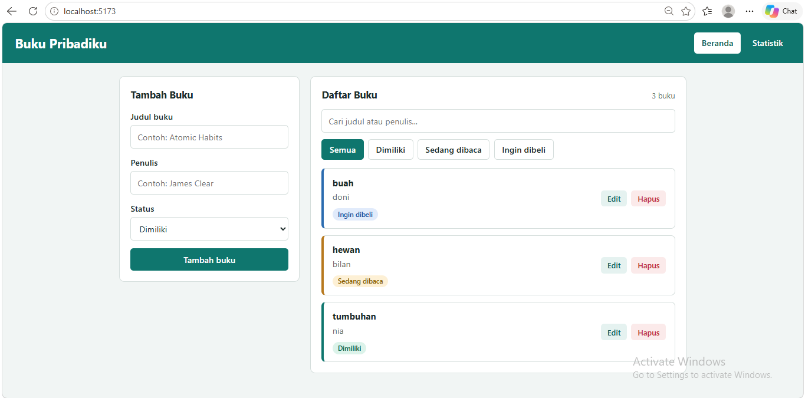
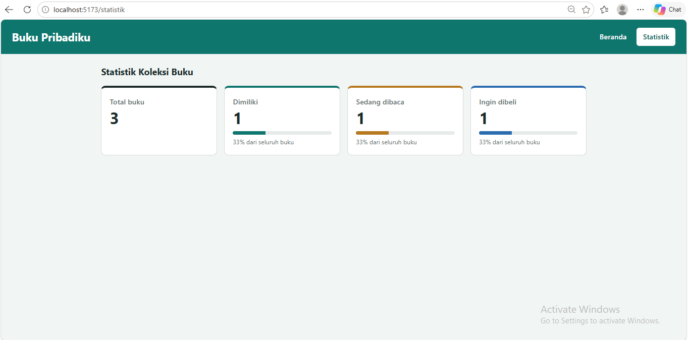
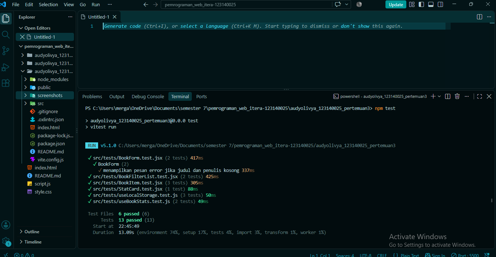

# Buku Pribadiku - Aplikasi Manajemen Buku Pribadi

## Identitas
- **Nama Lengkap:** [Audy Olivya Br Gurusinga]
- **NIM:** 123140025
- **Kelas Praktikum:** [123140025]

## Deskripsi Aplikasi
Buku Pribadiku adalah aplikasi web untuk mencatat buku yang dimiliki, sedang dibaca, atau ingin dibeli. Pengguna dapat menambah, mengedit, dan menghapus buku, mencari berdasarkan judul atau penulis, memfilter berdasarkan status, serta melihat statistik koleksi di halaman terpisah. Semua data tersimpan di `localStorage` sehingga tidak hilang saat halaman di-refresh.

Aplikasi dibuat dengan React (Vite), React Router, Context API, custom hooks, PropTypes, dan diuji dengan Vitest serta React Testing Library.

## Instalasi dan Cara Menjalankan
Pastikan **Node.js** (versi LTS) sudah terpasang.

```bash
# 1. Masuk ke folder project
cd audyolivya_123140025_pertemuan3

# 2. Pasang dependensi
npm install

# 3. Jalankan aplikasi
npm run dev

# 4. Jalankan unit test
npm test
```

Setelah `npm run dev`, buka alamat yang tampil di terminal (biasanya `http://localhost:5173/`).

## Daftar Fitur
- [x] Tambah buku (judul, penulis, status: dimiliki / sedang dibaca / ingin dibeli)
- [x] Edit dan hapus buku
- [x] Filter buku berdasarkan status
- [x] Pencarian berdasarkan judul atau nama penulis
- [x] Validasi form dengan pesan error dan bingkai merah
- [x] Halaman Statistik (total, jumlah, dan persentase per status)
- [x] Navigasi multi-halaman dengan React Router
- [x] Penyimpanan data persisten di `localStorage`

## Tangkapan Layar
| Tampilan | Gambar |
|---|---|
| Halaman Beranda |  |
| Validasi form |  |
| Halaman Statistik |  |

## Fitur React yang Digunakan
| Fitur | Penjelasan | Lokasi file |
|---|---|---|
| `useState` | Menyimpan isi form, pesan error, kata pencarian, filter status, dan buku yang diedit | `BookForm.jsx`, `BookContext.jsx` |
| `useEffect` | Menyimpan data ke `localStorage` setiap berubah, dan mengisi form saat mode edit | `useLocalStorage.js`, `BookForm.jsx` |
| `useMemo` | Menghitung hasil filter dan statistik hanya saat data berubah | `BookContext.jsx`, `useBookStats.js` |
| Context API | `BookProvider` dan `useBooks()` berbagi data dan fungsi ke semua komponen | `context/BookContext.jsx` |
| React Router | Rute `/` (Beranda) dan `/statistik` dengan `NavLink` | `App.jsx`, `main.jsx` |
| Custom hook 1 | `useLocalStorage`: seperti `useState` tetapi tersimpan di `localStorage` | `hooks/useLocalStorage.js` |
| Custom hook 2 | `useBookStats`: menghitung total, jumlah, dan persentase per status | `hooks/useBookStats.js` |
| Komponen reusable | `BookForm`, `BookList`, `BookItem`, `BookFilter`, `StatCard` | `components/` |
| PropTypes | Type checking props pada `BookItem`, `StatCard`, dan `BookProvider` | file komponen terkait |
| Error handling form | Judul dan penulis wajib diisi; pesan merah muncul di bawah kolom kosong | `BookForm.jsx` (fungsi `validate`) |

## Struktur Folder
```
src/
├── components/
│   ├── BookFilter/
│   ├── BookForm/
│   ├── BookItem/
│   ├── BookList/
│   └── StatCard/
├── context/
│   └── BookContext.jsx
├── hooks/
│   ├── useBookStats.js
│   └── useLocalStorage.js
├── pages/
│   ├── Home/
│   └── Stats/
├── tests/
├── App.jsx
├── constants.js
└── main.jsx
```

## Laporan Testing
Unit test memakai **Vitest** dan **React Testing Library**. Total **6 file test dengan 13 test**, seluruhnya lolos.

| File test | Yang diuji |
|---|---|
| `useLocalStorage.test.js` | Nilai awal, membaca data tersimpan, dan menyimpan data baru |
| `useBookStats.test.js` | Hitungan total, jumlah per status, dan persentase |
| `BookItem.test.jsx` | Tampilan data buku, tombol Edit, dan tombol Hapus |
| `BookForm.test.jsx` | Pesan error saat form kosong dan penyimpanan buku valid |
| `BookFilterList.test.jsx` | Pencarian dan filter status |
| `StatCard.test.jsx` | Tampilan label, angka, dan persentase |

Hasil eksekusi di terminal:

