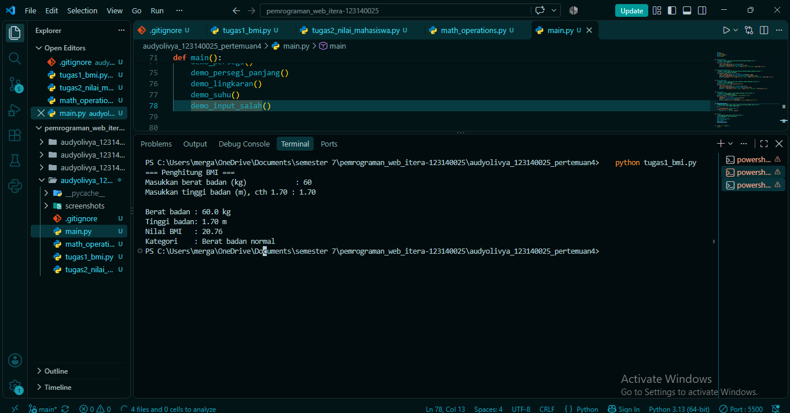
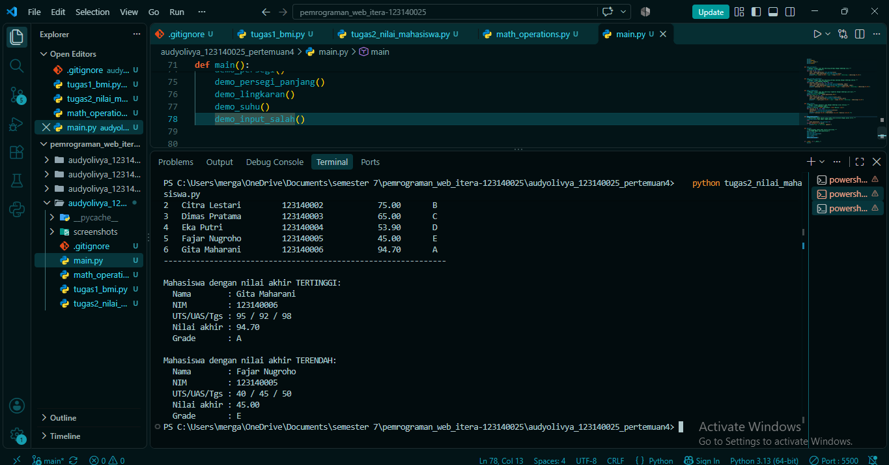
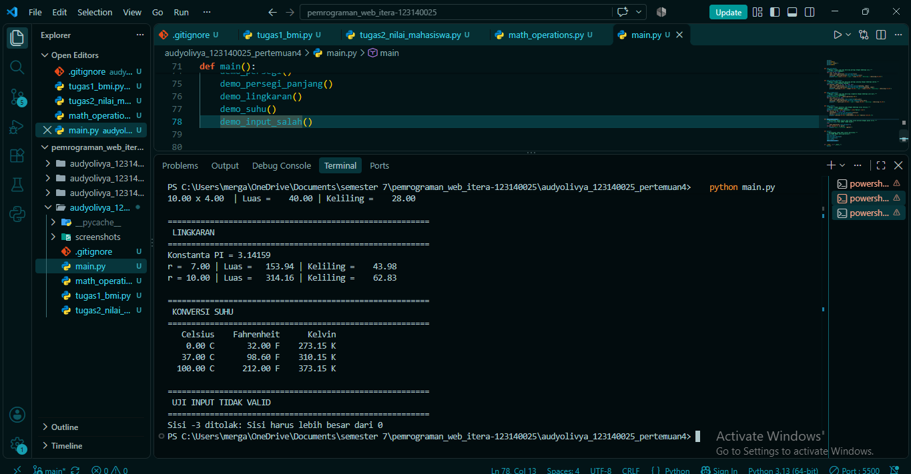

# Tugas Praktikum 4: Dasar Pemrograman Python

## Identitas
- **Nama Lengkap:** [Audy Olivya Br Gurusinga]
- **NIM:** 123140025
- **Kelas Praktikum:** [RB]

## Isi Folder
```
audyolivya_123140025_pertemuan4/
├── .gitignore
├── README.md
├── tugas1_bmi.py
├── tugas2_nilai_mahasiswa.py
├── math_operations.py
├── main.py
└── screenshots/
```

## Cara Menjalankan
Pastikan **Python 3** sudah terpasang (cek dengan `python --version`). Buka terminal di folder ini, lalu jalankan:

```bash
python tugas1_bmi.py
python tugas2_nilai_mahasiswa.py
python main.py
```

Catatan: jalankan `main.py` (bukan `math_operations.py`), karena `math_operations.py` hanya berisi modul fungsi.

## Soal 1: Penghitung BMI (`tugas1_bmi.py`)
**Fungsi program:** menghitung Body Mass Index dari berat dan tinggi badan, lalu menentukan kategorinya.

**Alur kerja:**
1. `baca_angka_positif()` meminta berat (kg) dan tinggi (m) lewat `input()`. Input yang bukan angka, nol, atau negatif ditolak dan diminta ulang.
2. `hitung_bmi()` menghitung `BMI = berat / (tinggi * tinggi)`.
3. `tentukan_kategori()` memakai `if-elif-else` untuk menentukan kategori:
   - BMI < 18.5: Berat badan kurang
   - 18.5 <= BMI < 25: Berat badan normal
   - 25 <= BMI < 30: Berat badan berlebih
   - BMI >= 30: Obesitas
4. `main()` mencetak nilai BMI (2 angka desimal dengan f-string) beserta kategorinya.

**Bukti eksekusi:**



## Soal 2: Pengelolaan Data Nilai Mahasiswa (`tugas2_nilai_mahasiswa.py`)
**Fungsi program:** mengolah data nilai mahasiswa, menampilkannya dalam tabel, dan mencari nilai tertinggi dan terendah.

**Alur kerja:**
1. `data_mahasiswa` adalah list berisi 6 dictionary dengan kunci `nama`, `nim`, `nilai_uts`, `nilai_uas`, dan `nilai_tugas`.
2. `hitung_nilai_akhir()` menghitung `30% * UTS + 40% * UAS + 30% * Tugas`.
3. `tentukan_grade()` menentukan grade: A (>= 80), B (70-79), C (60-69), D (50-59), E (< 50).
4. `proses_data()` menambahkan kunci `nilai_akhir` dan `grade` ke setiap mahasiswa dengan loop `for`.
5. `cetak_tabel()` mencetak tabel yang rata memakai perataan f-string.
6. `max()` dan `min()` dengan `key=lambda` mencari mahasiswa dengan nilai akhir tertinggi dan terendah.

**Bukti eksekusi:**



## Soal 3: Modul Matematika (`math_operations.py` dan `main.py`)
**Fungsi program:** `math_operations.py` adalah modul berisi fungsi geometri dan konversi suhu. `main.py` mengimpor modul itu lalu menguji semua fungsinya.

**Isi modul `math_operations.py`:**
- Konstanta: `PI = 3.14159`
- Persegi: `luas_persegi()` dan `keliling_persegi()`
- Persegi panjang: `luas_persegi_panjang()` dan `keliling_persegi_panjang()`
- Lingkaran: `luas_lingkaran()` dan `keliling_lingkaran()`
- Suhu: `celsius_ke_fahrenheit()` dan `celsius_ke_kelvin()`
- Ukuran yang tidak positif ditolak dengan `ValueError`.

**Dua cara impor di `main.py`:**
1. `import math_operations`: seluruh modul diimpor, fungsi dipanggil dengan awalan nama modul (contoh `math_operations.luas_persegi(5)`).
2. `from math_operations import celsius_ke_fahrenheit, celsius_ke_kelvin`: fungsi diimpor langsung dan dipanggil tanpa awalan.

**Alur `main.py`:** setiap fungsi `demo_...()` menguji satu kelompok fungsi dengan beberapa nilai, lalu mencetak hasilnya dalam format rapi.

**Bukti eksekusi:**



## Standar Kode
- Mengikuti PEP 8: indentasi 4 spasi dan penamaan `snake_case`.
- Setiap fungsi memiliki docstring yang menjelaskan parameter dan nilai kembaliannya.