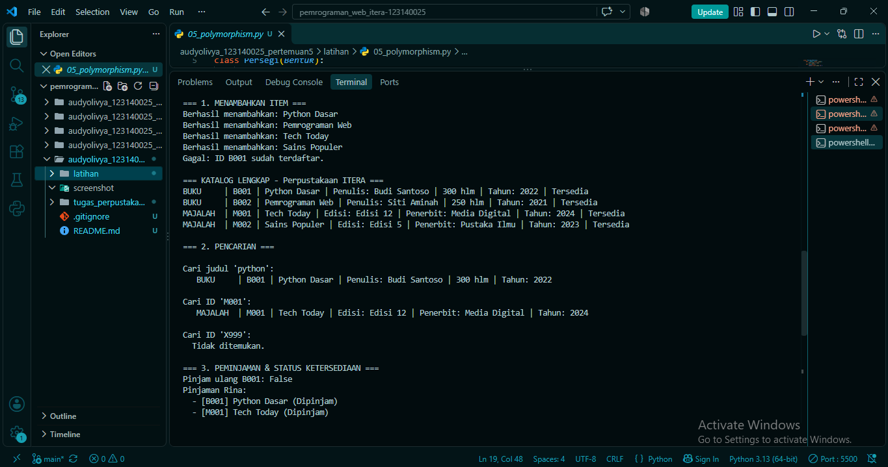

# Tugas Pertemuan 5 - Sistem Manajemen Perpustakaan Sederhana

## Identitas Mahasiswa
- **Nama Lengkap** : [Audy Olivya Br Gurusinga]
- **NIM**          : [123140025]
- **Kelas Praktikum** : [RB]

## Deskripsi Program
Program ini mengelola koleksi perpustakaan berupa buku dan majalah.

**Alur program:**
1. `main.py` membuat objek `Library`.
2. Item (`Book` dan `Magazine`) ditambahkan ke perpustakaan.
3. Katalog ditampilkan, lalu item dicari berdasarkan judul atau ID.
4. Anggota (`Member`) meminjam dan mengembalikan item, dan status ketersediaan ikut berubah.
5. Denda keterlambatan dihitung untuk tiap tipe item.

**Penerapan 4 pilar OOP:**
- **Class**: `LibraryItem`, `Book`, `Magazine`, `Member`, dan `Library` memodelkan objek nyata perpustakaan.
- **Inheritance**: `Book` dan `Magazine` mewarisi `LibraryItem` (abstract class) dan memakai ulang atribut serta method `pinjam()` dan `kembalikan()`.
- **Encapsulation**: atribut protected (`_judul`, `_item_id`) dan private (`__dipinjam`, `__tahun`, `__koleksi`, `__item_dipinjam`). Akses dilakukan lewat `@property` seperti `is_dipinjam` dan `judul`.
- **Polymorphism**: `get_detail()` dan `hitung_denda()` dipanggil dengan cara yang sama pada semua item, tetapi hasilnya berbeda untuk buku dan majalah.

## Struktur Folder
```
├── latihan/
├── tugas_perpustakaan/
│   ├── library_item.py
│   ├── member.py
│   ├── library.py
│   └── main.py
├── screenshot/
├── README.md
└── .gitignore
```

## Cara Menjalankan
```bash
cd tugas_perpustakaan
python main.py
```

